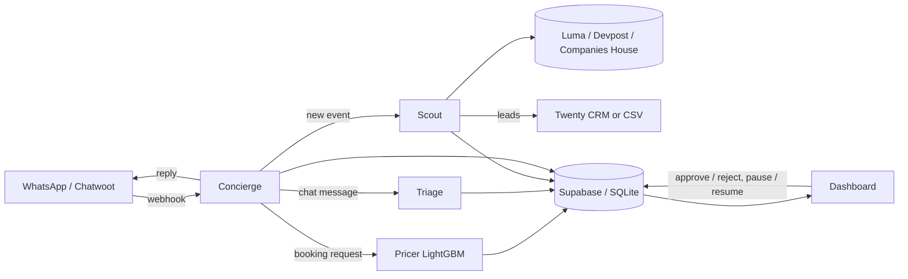

# FrontDesk OS

Four small bots and one control dashboard that run the front desk of a community venue such as Night Office.
Built for the London community engineering hackathon (22 Oct 2026), **Track 5: Front Desk & Revenue**. Open source under MIT.

| Bot | Folder | What it does |
|---|---|---|
| Concierge | `concierge/` | Inbound WhatsApp bot (WhatsApp Cloud API + Chatwoot webhooks). Answers FAQs, spots booking requests, hands off to a human when unsure. Mock CLI mode. |
| Pricer | `pricer/` | LightGBM model trained on booking history (synthetic for now). Quotes a price and explains community vs company rate from per-feature contributions. |
| Triage | `triage/` | Turns chat messages into tasks with urgency, category and owner. Rules first, optional LLM hook. |
| Scout | `scout/` | Sponsor CRM builder: Luma event JSON + Devpost + Companies House, scores leads, pushes to Twenty (CSV when no keys). |
| Dashboard | `dashboard/` | FastAPI + one HTML page: live activity feed, pause/resume per bot, approval queue for risky actions, bookings, revenue and the community pricing gap. |

## Architecture



Risky actions (discounted quotes over 15% off, sponsor outreach) never go out automatically; they land in the dashboard approval queue.

## Setup

```bash
python3 -m venv .venv && .venv/bin/pip install -r requirements.txt   # or: make install
cp .env.example .env   # optional; every key is optional, missing keys = mock mode
```

Storage is SQLite at `data/frontdesk.db` by default. For Supabase, run `supabase/schema.sql` in the SQL editor.

## Demo

```bash
./demo.sh          # installs deps on first run, trains the pricer, runs the end-to-end flow
make dashboard     # or: .venv/bin/uvicorn dashboard.app:app --port 8000  -> http://localhost:8000
```

The demo sends *"can I book the hall Friday for a coding meetup?"* and shows: Concierge reply, Pricer quote with explanation,
the quote in the approval queue (then approved), Triage creating "Set up chairs in the hall", and Scout suggesting 3 sponsors.
In the dashboard, type any message into the top bar to simulate WhatsApp, and use Pause/Approve buttons live.

Other entry points: `python -m concierge.bot` (interactive mock chat), `python -m pricer.train`, `make pricer-api` (`POST /quote`),
`python -m triage.triage "the projector is broken"`, `python -m scout.scout`. Webhooks: `GET/POST /webhook/whatsapp`, `POST /webhook/chatwoot`.

## What is mocked
- Booking history is synthetic (`pricer/generate_data.py`); swap in the Night Office export with the same columns.
- Luma, Devpost and Companies House use `scout/sample_data/` unless `DEVPOST_ENABLED=1` / `COMPANIES_HOUSE_API_KEY` are set.
- WhatsApp replies are logged, not sent, without `WHATSAPP_TOKEN`. Twenty push falls back to `scout/out/sponsor_leads.csv`.
- Availability is not checked against a calendar yet (Cal.com is the next step).

## License
MIT, see [LICENSE](LICENSE).

## Track 5 brief: Front Desk & Revenue

Answer inbound in chat, price bookings fairly, and find sponsors.

### What to build
- **Pricing engine** trained on a venue's real booking history. It quotes each request and explains the difference between community and company pricing (LightGBM).
- **Inbound bot** that replies in WhatsApp, qualifies the request, then books a call (Cal.com) or sends the quote.
- **Front desk** that turns every chat message into a task with an owner and a priority, and logs what it couldn't handle.
- **Sponsor CRM** that scrapes Luma event hosts and Devpost organisers, sizes them with Companies House and drafts the email. It runs in Zero or Twenty.

### Winning demo
A chat request comes in, gets qualified, priced from past bookings and quoted, then matched to a likely sponsor with a drafted email.

### Stack
Zero, Supabase, Grok Bot, Cursor. Starters: Chatwoot, Twenty, Frappe CRM, Cal.com, LightGBM.

### Data
- Luma event JSON: `https://api.lu.ma/event/get?event_api_id=...`
- Devpost: `https://devpost.com/api/hackathons?status[]=upcoming&search=london`
- Companies House: free API key
- BuilderBase discovery API
- Night Office redacted booking history (ask on the night)

### Judging
Prices that make sense on held-out bookings, fast and correct replies, sponsor matches that fit, and whether a venue would really use it.


